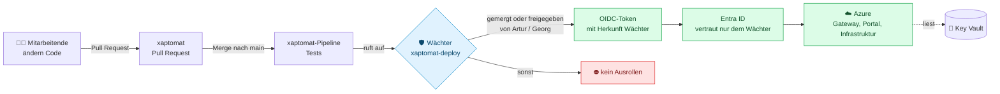
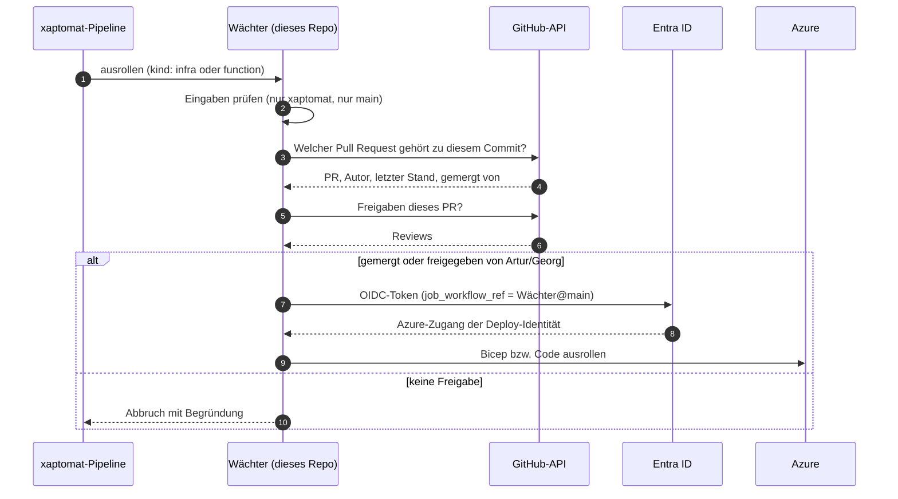

# xaptomat-deploy

**Der Wächter für das Ausrollen von [xapling/xaptomat](https://github.com/xapling/xaptomat) nach Azure.**

Alle bei Xapling dürfen am Code von xaptomat mitarbeiten. Nach Azure – und damit in die Nähe der Zugangsdaten im Key Vault – kommt aber nur, was **Artur Kuksin** oder **Georg Dörgeloh** freigegeben haben. Dieses Repo enthält genau eine Datei, die das prüft: [`.github/workflows/deploy.yml`](.github/workflows/deploy.yml).

## Das Problem

xaptomat besteht aus Function Apps in Azure. Das Integrations-Gateway darf die Zugangsdaten zu Fremdsystemen (z. B. MOCO) aus dem Key Vault lesen. Was im Gateway läuft, bestimmt der Code im Repo. Wer also Code nach Azure bringt, kommt indirekt an die Zugangsdaten – auch ohne selbst Zugriff auf den Tresor zu haben.

Im kostenlosen GitHub-Tarif hat jedes Mitglied der Organisation Schreibrecht, und `main` lässt sich in privaten Repos nicht schützen. Ein Push auf `main` hätte also gereicht.

## Die Lösung in einem Bild

Zwei Sperren greifen ineinander:

1. **Der Wächter prüft die Freigabe.** Er fragt GitHub, über welchen Pull Request der Stand kam, wer ihn gemergt und wer ihn freigegeben hat.
2. **Azure vertraut nur dem Wächter.** Die Deploy-Identität in Entra ID akzeptiert nur Anmeldetokens, deren Claim `job_workflow_ref` auf genau diese Datei auf `main` zeigt. Eine umgebaute Pipeline in xaptomat bekommt kein gültiges Token.

## Die Regel

Ein Stand von `xaptomat` wird nur ausgerollt, wenn er

1. über einen **gemergten Pull Request** nach `main` kam **und**
2. entweder von **Artur oder Georg gemergt** wurde (ihr Merge gilt als Freigabe)
   **oder** auf dem letzten Stand von **einem der beiden freigegeben** wurde – nie von der Person, die ihn gestellt hat.

Direkte Pushes auf `main` landen zwar im Repo, werden aber nie ausgerollt.

## Anwendungsfälle

| # | Situation | Ergebnis |
|---|---|---|
| 1 | Artur stellt einen Pull Request und mergt ihn selbst | ✅ wird ausgerollt |
| 2 | Eine Kollegin stellt einen Pull Request, Georg gibt frei, sie mergt | ✅ wird ausgerollt |
| 3 | Ein Kollege stellt einen Pull Request und Georg mergt ihn | ✅ wird ausgerollt (Georgs Merge gilt als Freigabe) |
| 4 | Ein Kollege stellt einen Pull Request und mergt ihn ohne Freigabe | ⛔ steht in `main`, wird nicht ausgerollt |
| 5 | Nach Georgs Freigabe schiebt jemand noch einen Commit nach | ⛔ Freigabe gilt nur für den freigegebenen Stand |
| 6 | Jemand pusht direkt auf `main` | ⛔ kein Pull Request, kein Ausrollen |
| 7 | Jemand baut die Pipeline in xaptomat um und meldet sich selbst an Azure an | ⛔ Token kommt nicht aus dem Wächter, Entra ID lehnt ab |
| 8 | Jemand legt in diesem Repo einen Zweig mit gelockertem Wächter an | ⛔ Entra ID vertraut nur `main` dieses Repos |
| 9 | Jemand will den Wächter auf `main` ändern | ⛔ `main` ist geschützt: nur per Pull Request, mergen nur Artur und Georg |

Geprüft am 30.10.2026: Fälle 1 und 4 im echten Betrieb, Fälle 2, 3 und 6 mit der Prüfregel gegen echte Pull Requests der Organisation. Fälle 5, 7 und 8 folgen aus der Prüfregel bzw. der Konfiguration in Entra ID und wurden nicht einzeln durchgespielt.

## Ablauf im Detail

## Wer darf was

| | Code in xaptomat ändern | Pull Request mergen | wird ausgerollt | Wächter ändern | Secrets im Key Vault pflegen |
|---|:-:|:-:|:-:|:-:|:-:|
| Artur, Georg | ✅ | ✅ | ✅ | ✅ (per Pull Request) | ✅ |
| übrige Mitglieder | ✅ | ✅ | nur mit Freigabe | ⛔ | ⛔ |

## Grenzen

- Die Admins der GitHub-Organisation könnten den Schutz dieses Repos ändern.
- Wird ein gescheiterter Lauf in xaptomat **wiederholt**, nutzt GitHub die Version des Wächters vom ursprünglichen Start. Nach einer Änderung am Wächter einen **neuen** Lauf starten.
- Der Schutz gilt fürs Ausrollen. Lesen kann den Code von xaptomat jedes Mitglied der Organisation.

## Warum öffentlich

Branch-Schutz gibt es im kostenlosen Tarif nur für öffentliche Repos. Dieses Repo enthält keine Geheimnisse, nur die Prüfregel; Kennungen für Azure liegen als Variablen in xaptomat.

## Einrichtung und Änderungen

- Einrichtung: `scripts/bootstrap-deploy-guard.sh` (dieses Repo anlegen und schützen) und `scripts/bootstrap-deploy-identity.sh` (Entra ID an den Wächter binden) in xaptomat.
- Änderungen nur per Pull Request; mergen dürfen nur die in [`CODEOWNERS`](.github/CODEOWNERS) genannten Personen.
- Ausführliche Beschreibung, Betrieb und Fehlersuche: `docs/10-ausrollen-mit-waechter.md` in xaptomat.
